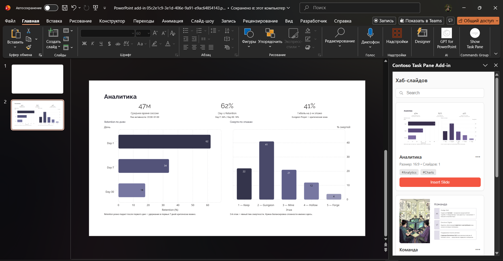
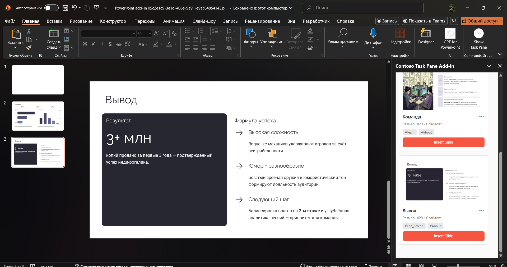

# PPT-SlideHub

**PPT-SlideHub** — это надстройка (Add-in) для Microsoft PowerPoint, предназначенная для централизованного хранения и быстрого использования корпоративной библиотеки слайдов.

Проект позволяет пользователям искать, просматривать и вставлять готовые слайды непосредственно в презентацию, не покидая PowerPoint. Основная цель — сократить время создания презентаций и обеспечить использование только актуальных и утвержденных материалов.

---

# Основные возможности

- 📂 Централизованная библиотека слайдов
- 🔍 Поиск необходимых слайдов
- 🖼️ Просмотр превью
- 📥 Вставка выбранных слайдов в презентацию
- ✅ Использование только актуальных корпоративных материалов
- ⚡ Работа непосредственно внутри Microsoft PowerPoint

---

# Скриншоты

## Главный экран



## Библиотека слайдов



---

# Используемые технологии

- JavaScript
- HTML
- CSS
- Office.js
- Microsoft Office Add-ins
- Node.js
- Webpack

---

# Структура проекта

```
PPT-SlideHub/
│
├── src/
│   ├── taskpane/
│   ├── commands/
│   └── ...
│
├── screenshots/
│   ├── screenshot-1.png
│   └── screenshot-2.png
│
├── manifest.xml
├── package.json
└── README.md
```

---

# Установка

## Требования

Перед запуском необходимо установить:

- Microsoft PowerPoint (Microsoft 365 или Desktop)
- Node.js
- npm

## Установка проекта

Склонируйте репозиторий:

```bash
git clone https://github.com/username/PPT-SlideHub.git
```

Перейдите в папку проекта:

```bash
cd PPT-SlideHub
```

Установите зависимости:

```bash
npm install
```

---

# Запуск

Для запуска надстройки выполните команду:

```bash
npm start
```

После запуска:

- будет запущен локальный сервер;
- откроется Microsoft PowerPoint;
- надстройка автоматически подключится (sideload);
- справа появится панель PPT-SlideHub.

Если автоматическое подключение не произошло, можно установить файл `manifest.xml` вручную через:

**Вставка → Мои надстройки → Загрузить мою надстройку**

---

# Описание проекта

Проект разработан на основе официального шаблона **Office Add-in Task Pane JavaScript**, предоставленного Microsoft.

В рамках MVP реализованы:

- интерфейс надстройки;
- каталог слайдов;
- поиск по библиотеке;
- просмотр превью;
- интеграция с Microsoft PowerPoint.

---

# Возможности для дальнейшего развития

В дальнейшем планируется добавить:

- подключение облачных хранилищ (OneDrive, SharePoint);
- авторизацию пользователей;
- систему категорий и тегов;
- избранные слайды;
- контроль версий материалов;
- аналитику использования библиотеки.

---

# Цель проекта

PPT-SlideHub предназначен для упрощения процесса подготовки презентаций и создания единой точки доступа к корпоративным слайдам.

Решение ориентировано на:

- бизнес-подразделения;
- консалтинговые компании;
- маркетинговые команды;
- продуктовые команды;
- аналитические отделы.

---

# Отладка

Для разработки и отладки можно использовать:

- Инструменты разработчика браузера;
- Microsoft Edge DevTools;
- Visual Studio Code;
- Office Add-in Debugging.

---

# Полезные ресурсы

- Документация Office Add-ins
- Office JavaScript API
- Microsoft 365 Developer Program

---

# Лицензия

Проект разработан в учебных целях в рамках создания MVP цифровой библиотеки слайдов для Microsoft PowerPoint.